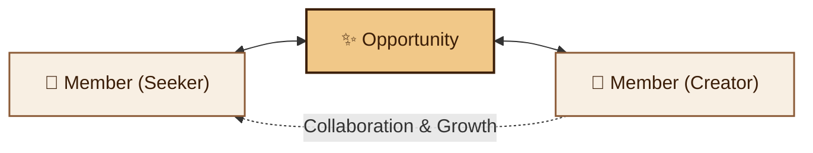
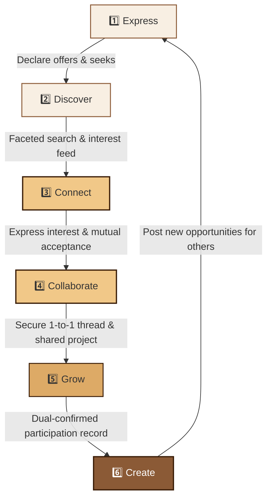
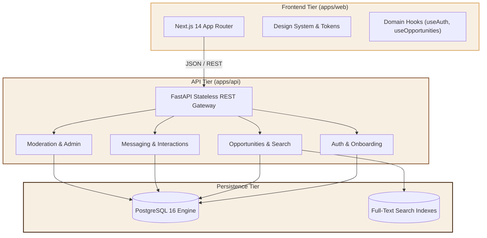

<div align="center">

# 🤝 CoCollaber

### *The Global Opportunity & Collaboration Ecosystem*

<p align="center">
  <strong>"What opportunity are you looking for, and what opportunity can you offer?"</strong>
</p>

[](file:///docs/PROGRESS.md)
[](https://fastapi.tiangolo.com)
[](https://nextjs.org)
[](https://www.typescriptlang.org)
[](https://python.org)
[](https://www.postgresql.org)

<br/>

[Product Vision](#-core-vision--philosophy) •
[Brand Identity](#-official-brand-identity) •
[Core Loop](#-core-product-loop) •
[Architecture](#-system-architecture) •
[Directory Layout](#-repository-structure) •
[Quickstart](#-local-development-setup) •
[Roadmap](#-phase-roadmap)

</div>

---

## 🌟 Core Vision & Philosophy

Existing platforms slice life into narrow, isolated silos: professional corporate networking, freelance gig marketplaces, employment boards, or fragmented messaging groups.

**CoCollaber** connects people from every domain—technology, arts, sports, music, research, business, and grassroots community impact—around concrete possibilities. 



### 🗝️ Confirmed Core Principles
* **Open & Inclusive:** Access depends on what you can do and want to do, not who you already know.
* **Domain-Agnostic:** Sports, research, creative arts, and technology are all first-class citizens.
* **Fluid Roles:** Every member can seek opportunities and create opportunities.
* **Mandatory Transparency:** Paid, unpaid, stipend, or recognition terms are explicitly declared upfront.
* **Foundational Trust & Safety:** Verified communication firewalls, reporting queues, and proactive safety guidelines.

---

## 🎨 Official Brand Identity

The interface is grounded in warm, organic, earthy tones that establish comfort and approachability across all devices:

| Token Name | Hex Code | Visual Sample | Usage |
|:---|:---:|:---:|:---|
| **Cream** | `#F8EFE3` | `████████` | Primary canvas & light surfaces |
| **Dark Cocoa** | `#3B1E08` | `████████` | Primary typography & high-emphasis headings |
| **Medium Mocha** | `#8B5A36` | `████████` | Secondary text, subtle borders & icons |
| **Warm Sand** | `#DDAA66` | `████████` | Component borders & structural outlines |
| **Soft Caramel** | `#F1C888` | `████████` | Highlights, active badges & accent cards |

---

## 🔄 Core Product Loop

CoCollaber operates on a self-reinforcing 6-step lifecycle:



---

## 🏛️ System Architecture

Built with a clean separation of concerns, strict type contracts, and asynchronous backend processing:



---

## 📁 Repository Structure

```text
cocollaber/
├── .editorconfig                          # Standard editor configuration
├── .env.example                           # Safe environment variable defaults
├── .gitignore                             # Language & framework ignore rules
├── .pre-commit-config.yaml                # Secret & hygiene pre-commit hooks
├── docker-compose.yml                     # Local container stack (API, Web, DB)
├── Makefile                               # Developer CLI commands
├── PROJECT_RULES.md                       # Engineering governance & rules
├── README.md                              # Visual project guide
│
├── docs/                                  # Specifications & Architecture
│   ├── PROGRESS.md                        # Authoritative phase tracker
│   ├── 00-idea/                           # Requirements & open decisions
│   ├── 01-architecture/                   # System design & DB schemas (Phase 1)
│   ├── 02-api/                            # OpenAPI contracts (Phase 2)
│   ├── 03-design-system/                  # Tokens & UI components (Phase 3)
│   ├── 04-integration/                    # E2E workflows & hardening (Phase 4)
│   ├── 05-quality/                        # Test plans & quality gates (Phase 5)
│   └── 06-cloud/                          # Deployment topologies (Phase 6)
│
├── apps/
│   ├── api/                               # FastAPI Backend (Python 3.12)
│   │   ├── app/
│   │   │   ├── core/                      # Config, constants, exceptions, security
│   │   │   ├── db/                        # Async session & SQLAlchemy 2.0 models
│   │   │   ├── middleware/                # CORS, error handling, rate limiting
│   │   │   ├── modules/                   # auth, members, opportunities, discovery,
│   │   │   │                              # interactions, messaging, participation, moderation
│   │   │   └── main.py                    # Entrypoint (/api/v1/health)
│   │   ├── tests/                         # Pytest unit & integration suites
│   │   └── pyproject.toml                 # Backend dependencies
│   │
│   └── web/                               # Next.js 14 Frontend (App Router)
│       ├── src/
│       │   ├── app/                       # (marketing), (auth), (dashboard), (admin)
│       │   ├── components/                # common, ui, opportunities, members, messaging
│       │   ├── design-system/             # tokens (colors, typography), primitives
│       │   ├── hooks/                     # Custom React state hooks
│       │   └── lib/                       # API client, formatters, domain constants
│       ├── public/brand/                  # Logo reference & brand assets
│       └── package.json                   # Web dependencies & scripts
│
├── packages/
│   └── api-client/                        # Shared type-safe API SDK
│
└── scripts/                               # Maintenance & domain seeders
```

---

## 🚀 Local Development Setup

### 1. Prerequisites
* **Python 3.12+**
* **Node.js 20+** & **npm 10+**
* *(Optional)* Docker & Docker Compose

### 2. Native Execution (Low RAM Mode)

#### Backend Service
```powershell
# Copy environment configuration
cp .env.example .env

# Run FastAPI backend locally
python -m uvicorn apps.api.app.main:app --host 0.0.0.0 --port 8000 --reload
```
* **API Health Check:** `http://localhost:8000/api/v1/health`
* **Interactive Docs:** `http://localhost:8000/docs`

#### Run Backend Verification Tests
```powershell
python -m pytest apps/api/tests/unit -v
```

#### Frontend Service
```powershell
cd apps/web
npm install
npm run dev
```
* **Web Application:** `http://localhost:3000`

---

## 🗺️ Phase Roadmap

| Phase | Milestone | Scope | Status |
|:---:|:---|:---|:---:|
| **Phase 0** | **Repository Foundation** | File tree, documentation, health endpoint, progress tracking | ✅ **COMPLETE** |
| **Phase 1** | **Architecture & DB Schema** | PostgreSQL schema, SQLAlchemy 2.0 async models, Alembic | 🟡 **READY** |
| **Phase 2** | **Backend APIs & Auth** | Registration, verify, opportunities CRUD, search, messaging | ⚪ *QUEUED* |
| **Phase 3** | **Frontend & Design System** | Next.js screens, brand tokens, responsive UI components | ⚪ *QUEUED* |
| **Phase 4** | **Integration & Hardening** | Full user loop, micro-animations, edge case resilience | ⚪ *QUEUED* |
| **Phase 5** | **Quality & CI/CD** | Automated test suites, GitHub Actions, security audits | ⚪ *QUEUED* |
| **Phase 6** | **Cloud & Cost Architecture** | Container staging/production, budget caps, observability | ⚪ *QUEUED* |

---

<div align="center">
  <sub>Built for global collaborators everywhere • CoCollaber © 2026</sub>
</div>
