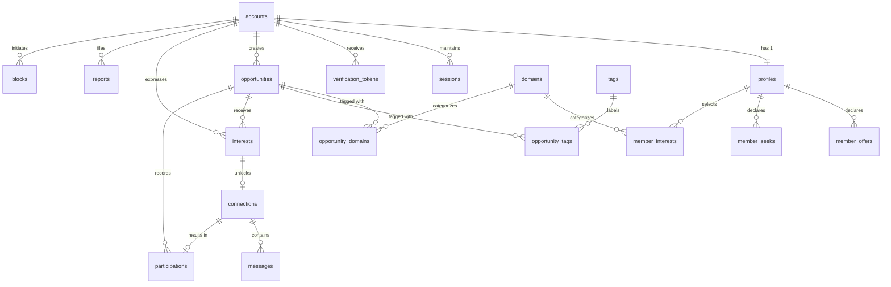
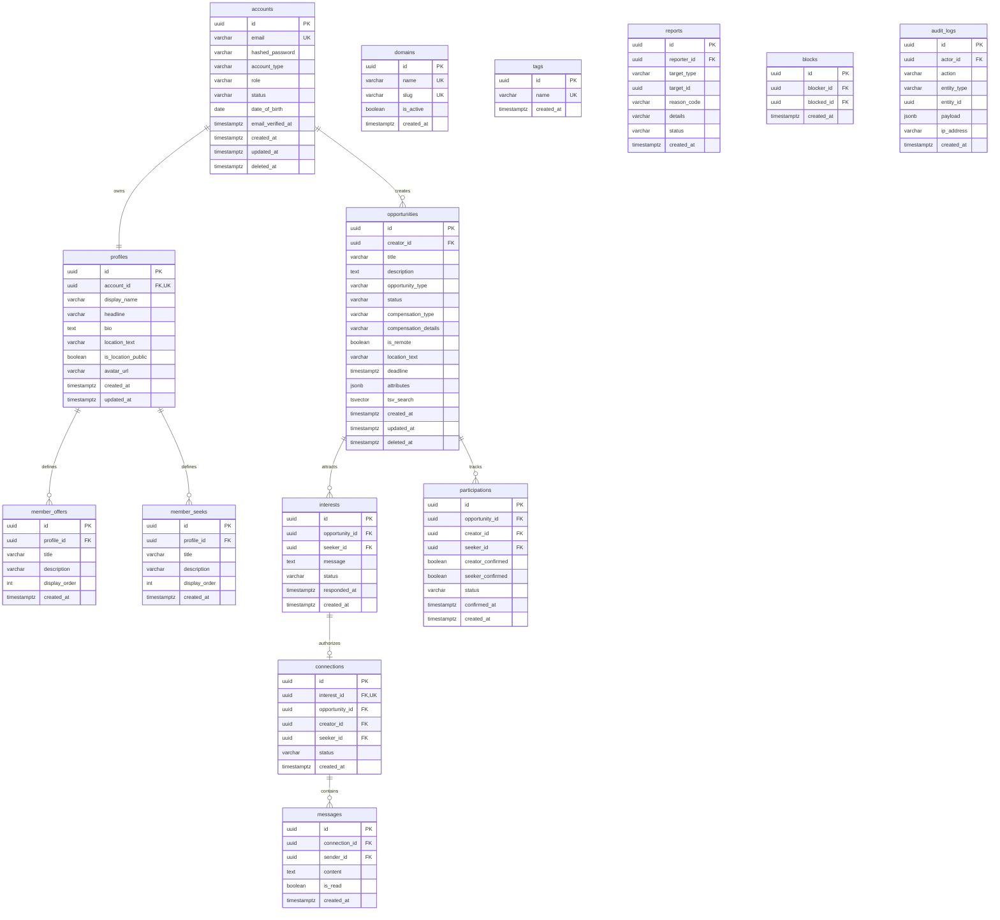

# CoCollaber — Entity Relationship Diagram (ERD)

**Document Stage:** Phase 1 Architecture Foundation  
**Status:** Approved ERD Baseline  
**Notation:** Crow's Foot Entity-Relationship Diagram (Mermaid)

---

## 1. High-Level Relational Architecture

---

## 2. Detailed Entity Attributes & Constraints

