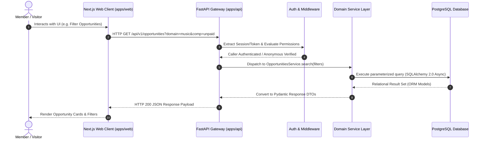
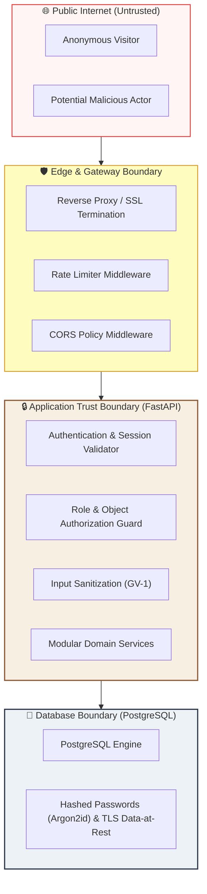

# CoCollaber — System Architecture Specification

**Document Stage:** Phase 1 Architecture Foundation  
**Status:** Approved Architecture Baseline  
**Scope:** Modular Monolith System Design, Request Lifecycles, Module Boundaries, and Security Models.

---

## 1. System Components and Responsibilities

CoCollaber is designed as a **Modular Monolith** optimizing for conceptual cohesion, rapid local development, strict operational boundaries, and zero microservice distribution tax:

1. **Client Tier (`apps/web`):**
   - Built on **Next.js 14 App Router** with strict TypeScript.
   - Responsibilities: Server-Side Rendering (SSR) for public opportunity pages (SEO & social sharing), Client Components for stateful reactive interfaces (faceted filtering, messaging threads, onboarding), and CSS custom property token enforcement.
2. **API Tier (`apps/api`):**
   - Built on **FastAPI (Python 3.12)**.
   - Responsibilities: Exposing OpenAPI-compliant REST endpoints, strict request validation via Pydantic v2 schemas, role- and object-level authorization enforcement, transactional orchestration, and application event emission.
3. **Persistence Tier (PostgreSQL 16):**
   - Responsibilities: ACID-compliant relational storage, declarative foreign-key integrity, multi-column compound indexes, JSONB for extensible attributes, and PostgreSQL native Full-Text Search (`tsvector` with GiST/GIN indexing).
4. **Caching & Queue Tier (Deferred / Redis):**
   - *Status:* Deferred in v1 per ADR-009 to conserve system RAM and eliminate unnecessary distributed dependencies until concurrency necessitates it.

---

## 2. Request and Response Flow

---

## 3. Communication Protocols

- **Frontend-to-Backend:** High-throughput JSON REST APIs over HTTP/2 (TLS in staging/production). CORS strictly configured for authorized frontend origins.
- **Backend-to-Database:** Asynchronous connection pooling via SQLAlchemy 2.0 and `asyncpg` driver, with `pool_pre_ping=True` and bounded connection limits.

---

## 4. Module Boundaries & Isolation

The backend adheres to a strictly modular structure under `apps/api/app/modules/`. Cross-module communication occurs via explicit service interfaces rather than raw, unchecked cross-table updates:

| Module Boundary | Core Responsibility | Key Entities Owned |
|---|---|---|
| **Identity & Accounts (`auth`)** | User registration, credential verification, sessions, account status | `Account`, `Session`, `EmailVerificationToken` |
| **Profiles & Identities (`members`)** | Fluid multi-identity profiles, offers (≤10), seeks (≤10), skills | `Profile`, `MemberOffer`, `MemberSeek`, `MemberInterest` |
| **Opportunities (`opportunities`)** | Creation, status lifecycle, compensation terms, location | `Opportunity`, `OpportunityDomain`, `OpportunityTag` |
| **Discovery & Search (`discovery`)** | Multi-faceted filtering, text search ranking, interest matching | Full-Text search query services, tag aggregations |
| **Responses & Connections (`interactions`)** | Express interest, creator accept/decline, withdrawal | `Interest`, `Connection` |
| **Messaging (`messaging`)** | Controlled 1-to-1 communication between accepted parties | `Thread`, `Message` |
| **Participation (`participation`)** | Dual-handshake start confirmation, collaboration records | `Participation` |
| **Trust, Safety & Moderation (`moderation`)** | User reporting, bidirectional blocking, admin moderation | `Report`, `Block`, `ModerationAction` |
| **Administration (`admin`)** | System audit trails, curated domain and taxonomy management | `AuditLog`, `Domain`, `Tag` |

---

## 5. Configuration and Secrets Flow

1. **Environment Variables:** All runtime configuration is driven by typed environment variables read via Pydantic `BaseSettings`.
2. **Strict Secret Hygiene:** No secrets, credentials, or keys are committed to Git. The `.env.example` file contains only safe, dummy placeholders.
3. **Precedence Hierarchy:** System Environment Variables > `.env` file (local development only) > Defaults in `config.py`.

---

## 6. Logging, Error Handling & Observability

- **Structured Logging:** Standardized JSON formatting with correlation IDs, timestamps (UTC), caller context, and sanitized payloads (passwords, tokens, and PII are stripped).
- **Error Taxonomy:** Mapped directly to SRS conventions:
  - `E-VAL`: 400 Bad Request (Validation failure)
  - `E-AUTH`: 401 Unauthorized (Missing/invalid credentials)
  - `E-FORB`: 403 Forbidden (Object authorization failure)
  - `E-NF`: 404 Not Found (Missing or hidden resource)
  - `E-CONF`: 409 Conflict (Duplicate email, re-application conflict)
  - `E-STATE`: 422 Unprocessable Entity (Invalid lifecycle state transition)
  - `E-RATE`: 429 Too Many Requests (Rate limit tripped)
  - `E-SYS`: 500 Internal Server Error (Unhandled exception)

---

## 7. Scalability Considerations

- **Stateless App Nodes:** The FastAPI application maintains zero in-memory session state. All session state resides in database tables/tokens, allowing seamless horizontal scale-out behind an NGINX/ALB reverse proxy.
- **Database Index Optimization:** Compound indexes on `(status, created_at)` and partial indexes on active records ensure queries execute in `< 50ms` even as row counts grow.
- **Search Abstraction:** Discovery operations are isolated behind `DiscoveryService`, enabling future migration from PostgreSQL FTS to dedicated search engines (Meilisearch/Elasticsearch) without changing API contracts.

---

## 8. Security Boundaries and Trust Assumptions

### Trust Boundary Rules
1. **Zero Client Trust:** All data submitted from the frontend is treated as untrusted and re-validated against strict Pydantic schemas.
2. **Object-Level Firewall:** Ownership is validated on every mutation (`caller_id == opportunity.creator_id`).
3. **Communication Firewall:** Members cannot initiate direct chat messages without mutual acceptance of an expression of interest.
