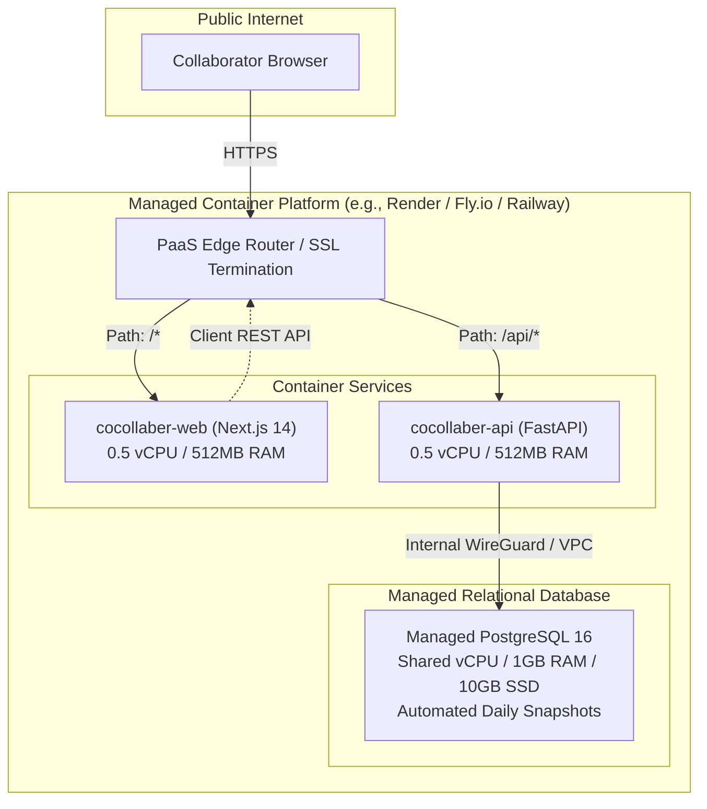
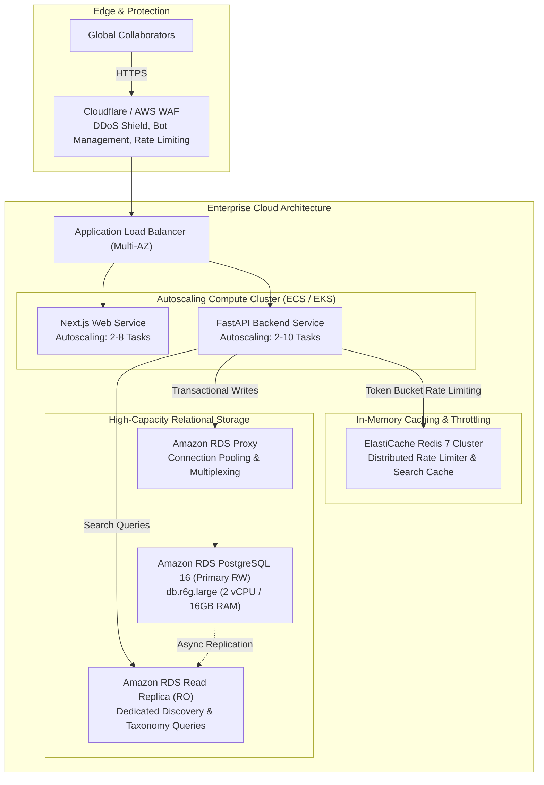

# CoCollaber Cloud Architecture: Deployment Topologies

This document specifies three production topologies tailored to CoCollaber’s technical architecture, budget constraints, and traffic milestones.

---

## 1. Topology A — Minimal-Cost Pilot (100 MAU)

### Overview
Designed for initial alpha testing, closed user trials, and developer preview with minimal operational overhead and near-zero idle cost.



### Component Details
- **Frontend Compute**: Containerized Next.js 14 standalone service running on 512MB RAM / 0.5 shared CPU.
- **Backend Compute**: Containerized FastAPI Python 3.12 service running on 512MB RAM / 0.5 shared CPU.
- **Database**: Managed PostgreSQL 16 starter instance with daily snapshot backups.
- **Networking**: Built-in Let's Encrypt automated TLS certificate issuance; private internal network bridge between API and PostgreSQL.

### Limits & Trade-Offs
- **Availability**: Single-region (typically `us-east` or `eu-central`). Downtime during host maintenance.
- **Scaling Limits**: Vertical scaling only; cold starts if scaled to zero.
- **Estimated Cost**: **\$15 – \$25 / month**.

---

## 2. Topology B — Managed Production Deployment (1,000 MAU)

### Overview
Recommended baseline for reliable, secure, and production-grade public launch. Built using managed container services and isolated VPC networks.

```mermaid
flowchart TD
    subgraph Clients ["Public Clients"]
        Browser["Collaborator Browser (HTTPS)"]
    end

    subgraph AWS ["Cloud Environment (AWS / GCP)"]
        CF["CloudFront / Cloud CDN<br/>Edge Caching & TLS 1.3"]
        
        subgraph VPC ["Virtual Private Cloud (VPC) - 10.0.0.0/16"]
            subgraph PublicSubnet ["Public Subnets (Multi-AZ)"]
                ALB["Application Load Balancer (ALB)<br/>Path Routing & Health Checks"]
            end
            
            subgraph PrivateAppSubnet ["Private App Subnets (Multi-AZ)"]
                ECS_Web["ECS Fargate: Web Service<br/>(2 Tasks x 0.5 vCPU / 1GB RAM)"]
                ECS_API["ECS Fargate: API Service<br/>(2 Tasks x 0.5 vCPU / 1GB RAM)"]
            end
            
            subgraph PrivateDBSubnet ["Private Isolated DB Subnets"]
                RDS["Amazon RDS PostgreSQL 16<br/>db.t4g.small (2 vCPU / 2GB RAM)<br/>Multi-AZ Standby + Daily Backups"]
            end
        end
        
        Secrets["AWS Secrets Manager<br/>Encrypted Credentials & Session Keys"]
        CW["CloudWatch Logs & Metrics<br/>Alarms & Audit Trails"]
    end

    Browser -->|HTTPS| CF
    CF -->|Static Assets| CF
    CF -->|Dynamic API & SSR| ALB
    ALB -->|Host: app.cocollaber.com| ECS_Web
    ALB -->|Host / Path: /api/*| ECS_API
    ECS_Web -.->|REST Requests| ALB
    ECS_API -->|TCP 5432 (Private SG)| RDS
    ECS_API -.->|IAM Auth| Secrets
    ECS_API & ECS_Web -.->|Stdout Logs| CW
```

### Component Details
- **Edge Routing**: CloudFront distribution with HTTPS redirection, custom domain (`cocollaber.com`), and TLS 1.3.
- **Compute Layer**: AWS ECS Fargate or Google Cloud Run running in private subnets across two Availability Zones with rolling zero-downtime deployments.
- **Database**: Amazon RDS PostgreSQL 16 (`db.t4g.small` or `db.t4g.medium`) with automated Multi-AZ replication, 7-day point-in-time recovery (PITR), and KMS encryption at rest.
- **Security Boundaries**: Database is completely isolated in non-routable private subnets. Security group only permits inbound TCP 5432 from ECS API task security group.
- **Estimated Cost**: **\$95 – \$165 / month**.

---

## 3. Topology C — Growth-Oriented Scale Architecture (10,000+ MAU)

### Overview
High-availability, horizontally autoscaling topology supporting surge traffic, low-latency discovery caching, and connection pooling.



### Component Details
- **WAF & Edge**: Edge rate limiting to drop malicious traffic before hitting application compute.
- **Connection Pooling**: Amazon RDS Proxy / PgBouncer manages database connection pooling, preventing connection exhaustion during horizontal task scaling.
- **Read/Write Splitting**: Heavy discovery search queries routed to read replicas, preserving primary instance capacity for mutations, authentication, and messaging.
- **Distributed Cache**: Redis cluster manages cross-instance sliding-window rate limiting (429 `E-RATE-001`) and caches taxonomy and domain definitions.
- **Estimated Cost**: **\$380 – \$680 / month**.
